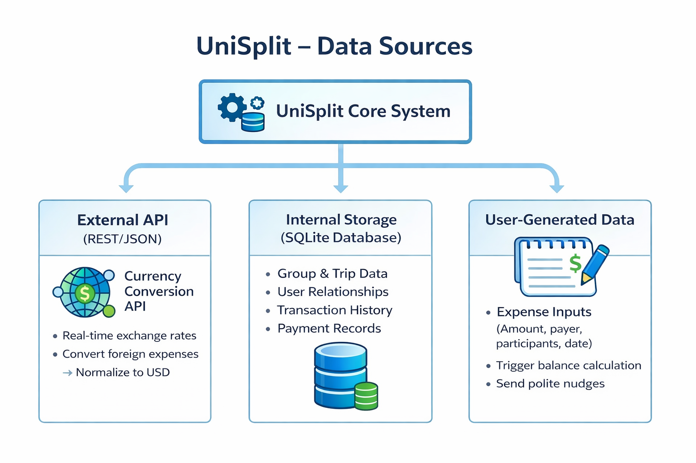
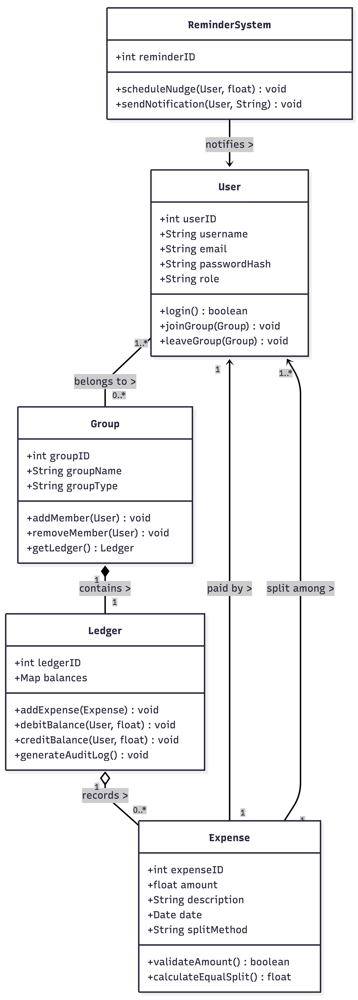

# UniSplit: Initial Design Document

---

## 1. Architecture
UniSplit utilizes a hybrid architecture combining an internal core system with external API integrations. The system is hosted on cloud infrastructure (e.g., AWS or Google Cloud) to ensure reliable database and server maintenance. The architecture is divided into three main data flow components:

* **External API (REST/JSON)**: Handles real-time currency conversion for international trips.
* **Internal Storage**: Relational database managing users, groups, and transaction history.
* **User-Generated Data**: Client-side inputs triggering balance calculations and notifications.

## 2. Class Design
*(Note: Please insert or link your UML Class Diagram here. Based on the system requirements, your core classes should likely include:)*

* `User`: Attributes for credentials (hashed passwords) and relationships.
* `Group`: Attributes for group members, trip details, and ledger references.
* `Expense`: Attributes for amount, payer, participants, date, and description.
* `Ledger`: Methods for atomic balance updates and audit logging.
* `ReminderSystem`: Logic for the proprietary "polite nudge" algorithm.

## 3. Database Design
The internal data storage utilizes a relational SQLite database. The schema is designed to track complex relationships and maintain ledger integrity:

* **Group and Trip Data**: Stores information about user groups, specific trips, and individual group members. This supports the relationships between users in shared living situations or travel events.
* **Transaction and Payment History**: Securely records all expense entries, calculated splits, and settlement events. This historical data is required to display past transactions, calculate real-time balances, and generate analysis charts.

## 4. APIs
* **Currency Conversion API**: Integrates with a REST/JSON web API (e.g., ExchangeRate-API or Open Exchange Rates). It fetches real-time exchange rates to normalize foreign expenses into a single base currency (USD) for accurate final calculations.
* **Payment Integration Links**: Seamlessly links to third-party apps like Venmo or Zelle to settle debts instantly.

## 5. Testing Approach
The testing strategy focuses on ensuring accuracy and system integrity. As defined in the core use cases, every step of the expense splitting process is observable and testable.

* Unit testing will target the calculation logic (ensuring equal split per participant).
* Integration testing will verify the ledger update process and external API connections.

## 6. Error Handling
The system implements strict alternate flows for error handling to guarantee no partial ledger entries or unauthorized modifications:

* **Invalid Amount**: If the system detects an amount less than or equal to 0, it rejects the expense, displays an error message, and no ledger changes occur.
* **Invalid Participant**: If a participant is not in the group, the system rejects the submission, displays an error message, and no ledger changes occur.
* **System Failure**: If the system fails before a ledger commit, it rolls back the transaction, ensures no partial balances are updated, and logs the failure. This satisfies the principle that "undefined behavior is still behavior".

## 7. Non-Functional Requirements (Security & Performance)

* **Performance**: Transactions must complete within 2 seconds.
* **Integrity & Consistency**: Ledger updates must be atomic. The system must maintain consistency of group balances.
* **Security (Idempotency)**: The system must prevent duplicate submissions to ensure idempotent behavior.
* **Security (Authentication)**: Administrator restrictions ensure that private user credentials, such as passwords, are stored as hashed values only.
* **Auditability**: Every expense must generate an audit log entry. Administrators cannot modify group balances without generating an audit record.